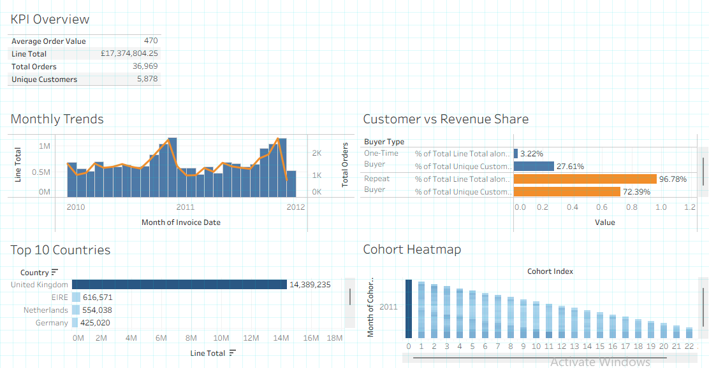

# E-Commerce Customer Retention & Revenue Concentration Analysis

[](https://www.postgresql.org/)
[](https://www.python.org/)
[](https://public.tableau.com/)
[](https://www.microsoft.com/excel)
[](https://git-scm.com/)

An end-to-end data analytics project evaluating customer acquisition cohorts, retention decay, order cadences, and Pareto revenue concentration for a UK-based non-store retail enterprise across 779,407 validated transactions.

---

## Executive Dashboard Preview



---

## Project Overview & Business Context

In non-contractual retail and e-commerce business models, customer attrition occurs silently. Without proactive visibility into purchasing cadences and cohort retention, leadership risks misallocating marketing budgets toward low-quality, one-time seasonal acquisitions while neglecting core repeat buyers.

This project delivers an end-to-end analytical audit of transactional performance from **December 2009 to December 2011**, uncovering the behavioral drivers of customer loyalty, quantifying revenue concentration, and providing defensible re-engagement recommendations.

### Key Business Questions Investigated
1. **Macro Performance:** What are the baseline business metrics (gross revenue, order volume, unique customer count, and AOV)?
2. **Seasonality:** How do transaction volumes and revenue distribute across months and peak holiday restocking windows?
3. **Retention & Cohorts:** How does cohort retention decay across monthly offsets, and do accounts demonstrate recurring seasonality?
4. **Repurchase Cadence:** What is the typical elapsed time between consecutive customer orders?
5. **Pareto Concentration:** What proportion of gross revenue is generated by repeat buyers versus one-time buyers?
6. **Product Drivers:** Which catalog items drive initial customer acquisition versus ongoing inventory replenishment?

---

## Technical Pipeline & Tools Used

```text
[Raw Excel Source (UCI Online Retail II)]
                   │
                   ▼
  Phase 1: Excel Data Audit & Anomaly Profiling
                   │
                   ▼
  Phase 2: PostgreSQL Ingestion, Schema DDL & Cleaning
                   │
                   ▼
  Phase 3-5: Advanced SQL Modular Queries (14 Business Questions)
                   ├── 03_kpi_overview.sql
                   ├── 04_retention_cohorts.sql
                   └── 05_customer_segments.sql
                   │
         ┌─────────┴─────────┐
         ▼                   ▼
  Phase 6A: Python    Phase 6B: Tableau Public
  (Pandas/Seaborn)    (Interactive 5-Sheet
  Heatmap Generation  Executive Dashboard)
         │                   │
         └─────────┬─────────┘
                   ▼
  Phase 7: Executive Strategy & Portfolio Documentation
Microsoft Excel: Source data structural audit, initial anomaly profiling, and data dictionary formulation.PostgreSQL: Relational schema construction, deterministic data cleaning (cancellation filtering, missing customer ID handling), and advanced analytical SQL queries (window functions, CTEs, percentiles, NTILE).Python (pandas, seaborn, matplotlib): Data reshaping, wide-format matrix transformations, and statistical cohort heatmap visualization.Tableau Public: Interactive multi-sheet executive dashboard featuring dynamic KPI cards, dual-axis seasonality charts, Pareto splits, and cross-filtering.Git & VS Code: Atomic version control, branch discipline, and professional repository scaffolding.Core Findings & Analytical ResultsMetric CategoryValidated BenchmarkStrategic InterpretationGross Revenue£17,374,804.25Total validated sales over 24 calendar months.Total Invoices / Orders36,969Distinct transaction baskets (excluding cancellations).Customer Population5,878Unique identifiable retail and trade accounts.Average Order Value (AOV)£469.98Overall commercial transaction baseline.Repeat Buyer Revenue Share96.78%Repeat accounts drive almost the entire commercial enterprise.Repeat vs. One-Time Spend£3,951.71 vs. £345.21Repeat buyers exhibit an 11.4x higher Lifetime Value (LTV).Pareto Decile 10 Share63.90%The top 10% highest spenders generate nearly two-thirds of revenue.Median Repurchase Cadence25.0 DaysHalf of returning customers order again in under a month.Cohort Retention Heatmap AnalysisThe Month-1 Cliff: Retention drops from 100% to between 18% and 35% in Month 1 across cohorts.Wholesale Floor Stability: Rather than declining to zero, retention rates stabilize between 15% and 25% for up to two years.Q4 Seasonality Bands: Diagonal analysis confirms that dormant customers re-engage heavily in November of each year to restock inventory before peak retail holidays.Repository StructurePlaintext├── dashboard/
│   └── customer_retention_dashboard.twbx   # Tableau Public packaged workbook
├── data/
│   ├── audit_summary.xlsx                  # Initial audit documentation
│   ├── cohort_retention_rates.csv          # Aggregated matrix for Python
│   └── .gitignore                          # Excludes raw data extract (>100MB)
├── findings/
│   └── executive_summary.md                # Comprehensive business recommendations
├── images/
│   ├── dashboard.png                       # High-res executive dashboard export
│   └── retention_heatmap.png               # High-res Python cohort heatmap
├── notebooks/
│   └── retention_analysis_heatmap.ipynb    # Python matrix pivot & Seaborn script
├── sql/
│   ├── 01_data_exploration.sql             # Source table profiling & null audits
│   ├── 02_data_cleaning.sql                # Production cleaning views & DDL
│   ├── 03_kpi_overview.sql                 # Macro revenue, volume, and geography
│   ├── 04_retention_cohorts.sql            # Longitudinal cohort matrix & cadences
│   └── 05_customer_segments.sql            # Pareto deciles & gateway product demand
└── README.md                               # Project documentation & summary
How to Reproduce This Analysis1. 
1.Database Setup (PostgreSQL)
  Create a database named online_retail_db.
  Execute sql/02_data_cleaning.sql to generate the sanitized view cleaned_retail_sales.
  Run the analytical scripts sequentially (03_kpi_overview.sql, 04_retention_cohorts.sql, 05_customer_segments.sql).
2.Python Environment & Visuals
  Ensure Python 3.9+ is installed.
  Install required packages:Bashpip install pandas seaborn matplotlib numpy
  Open and run notebooks/retention_analysis_heatmap.ipynb.
3.Tableau Dashboard
  Open Tableau Public or Tableau Desktop.
  Load dashboard/customer_retention_dashboard.twbx to interact with cross-filters and visual sheets.